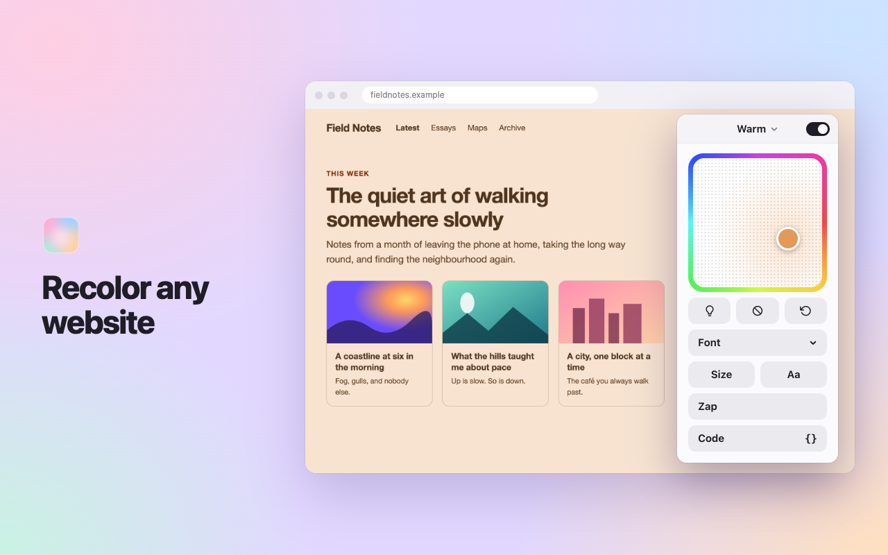
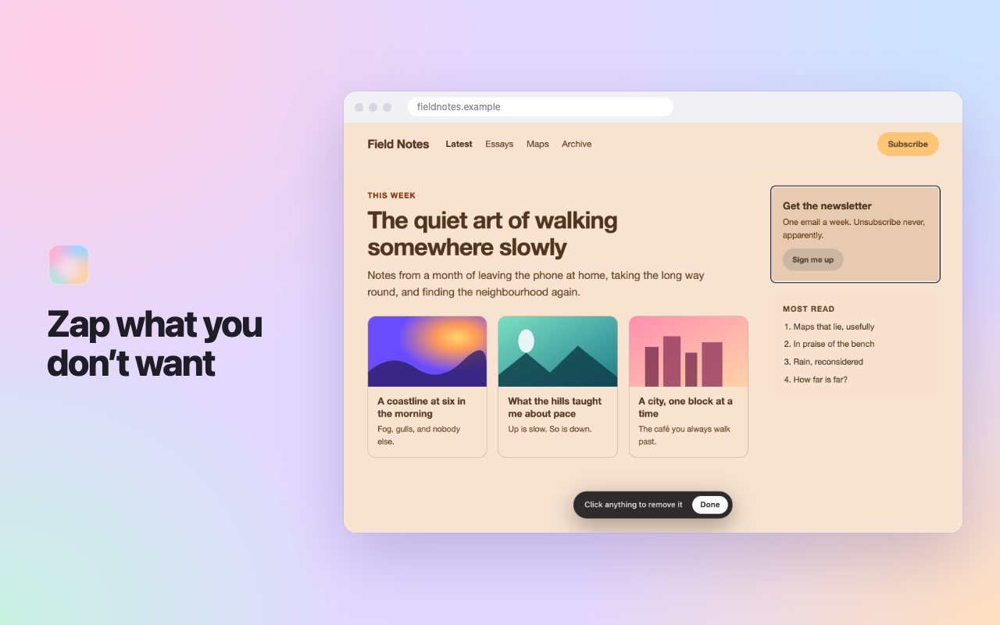
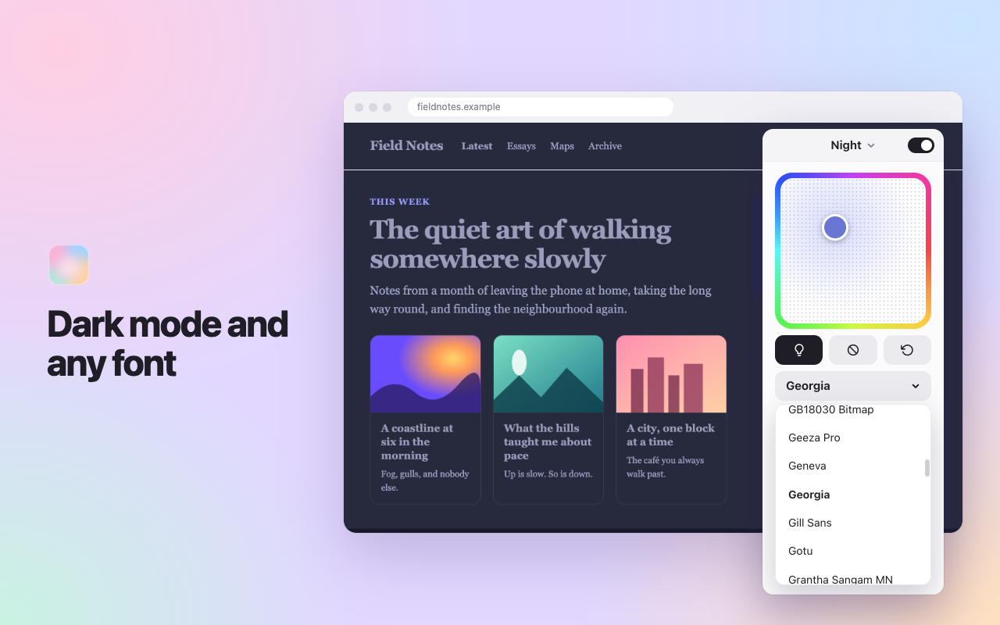
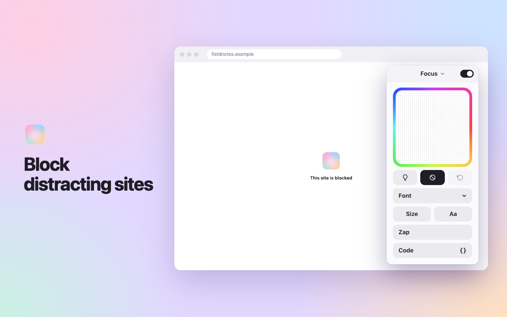
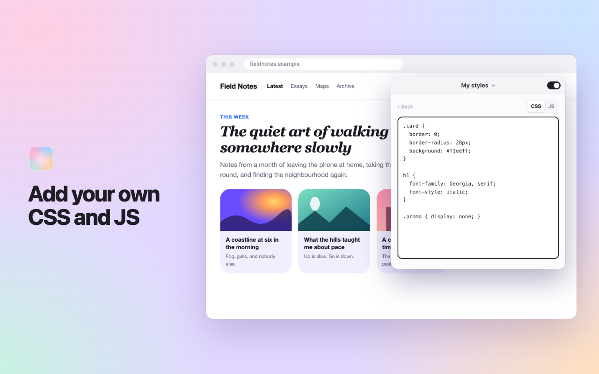
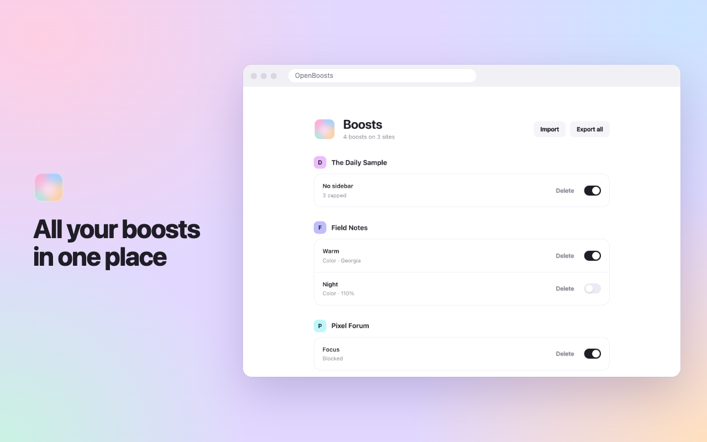

<h1 align="center">OpenBoosts</h1>

<b>Make any website yours.</b> Recolor it, restyle it, zap what you don't want. For every Chromium browser.

OpenBoosts is a browser extension that changes the websites you use and keeps them changed. Open a site, click the icon, and it is yours to recolor, restyle and trim. It is modeled on the Boosts feature of the Arc browser, and works in Chrome, Brave, Edge, Vivaldi, Opera and anything else built on Chromium.

No account, no server, no analytics. Your boosts stay in your browser.

 

<b>Drag on the color square and the whole site follows.</b> Backgrounds, text and borders change. Photos and video stay as they are.

 

<b>Click anything on a page to remove it for good.</b> If it is one of a repeating set, like cards or suggested posts, remove them all at once.

 

<b>Flip any site between light and dark, in any font on your computer.</b> Step the size up or down, and switch the letter case.

 

<b>One key, and the site stops opening.</b> It stays blocked until you switch the boost off on the All Boosts page.

 

<b>For when a button isn't enough.</b> CSS applies as you type. JS runs on every load of the site.

 

<b>Every site you have boosted, in one list.</b> Switch boosts on and off, delete them, and export or import them as files.

 

## Coming from Arc

CSS and JavaScript written for an Arc boost run here unchanged: paste them into **Code**.

## Privacy

OpenBoosts collects nothing. See [PRIVACY.md](PRIVACY.md).

## License

MIT. OpenBoosts is an independent project and is not affiliated with or endorsed by The Browser Company.
